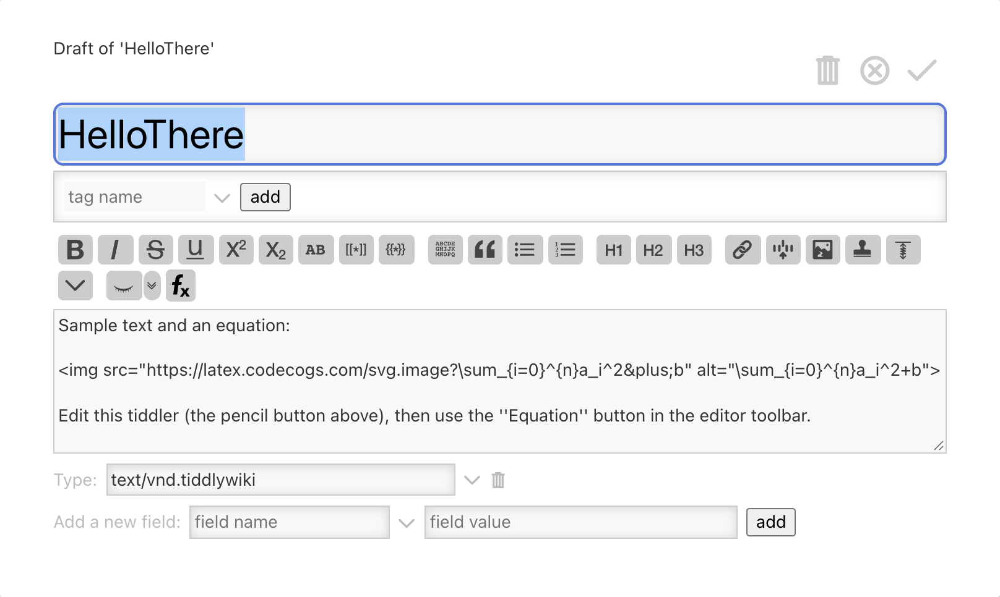
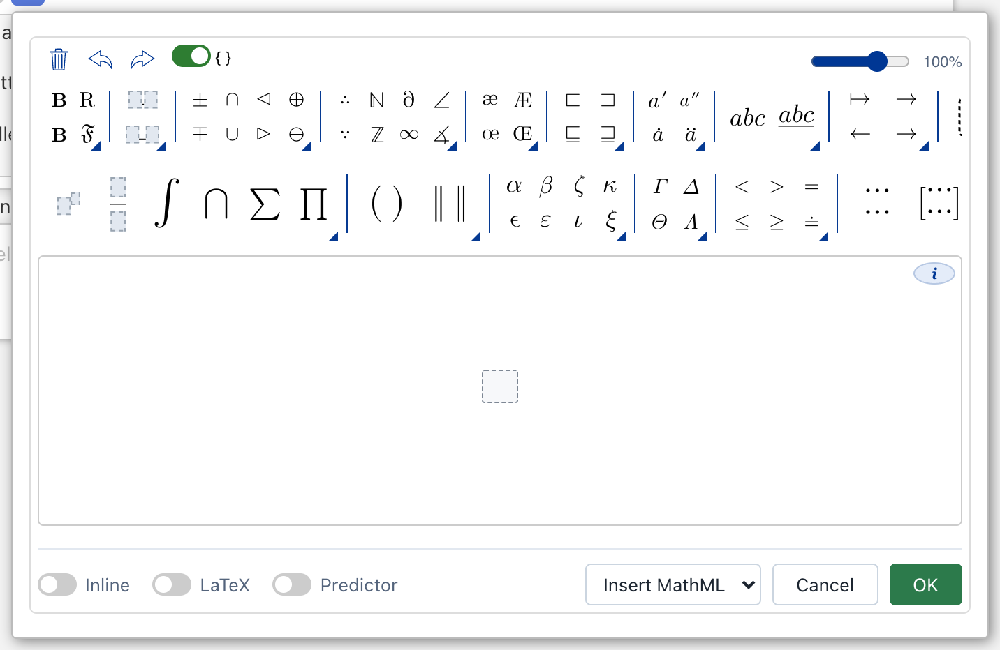

# fxEditor for TiddlyWiki

The fxEditor plugin for [TiddlyWiki](https://tiddlywiki.com) 5.4 and later adds an
**Equation** button to the tiddler editor's toolbar. It opens fxEditor, CodeCogs' equation
editor - a toolbar of symbols and structures, a LaTeX view and a rendered maths view - and
inserts the equation into the tiddler at the cursor, as MathML (the default, which TiddlyWiki
displays natively) or as an SVG image. The equation goes into the tiddler's text as markup;
there is no way to reopen an inserted equation in the editor, so to change one, insert it again
and delete the old markup.

It has been tested against TiddlyWiki 5.4.1.

## Screenshots



*A tiddler in edit mode: the **Equation** button (fx) is at the end of the editor toolbar.*



*The equation editor that the **Equation** button opens.*

## Links

- Documentation and live demo: https://fxplugins.codecogs.com/docs/tiddlywiki.html
- Customise and download: https://fxplugins.codecogs.com/docs/tiddlywiki.html#customise
- All fxEditor plugins: https://fxplugins.codecogs.com
- fxEditor: https://fxeditor.codecogs.com

## Installing from git

The plugin is installed into a wiki as a single file, `codecogs-eqneditor.json`, which is built
from `plugin/` in this repository. Building needs Node.js; the build script fetches TiddlyWiki
5.4.1 itself with `npx`.

```bash
git clone https://github.com/willzyba/tiddlywiki.git
cd tiddlywiki
./test-wiki/build.sh
```

This writes `test-wiki/output/codecogs-eqneditor.json`. Drag it onto your wiki in the browser
and confirm the import, then save and reload. The **Equation** button appears in the editor
toolbar.

For a wiki run with TiddlyWiki on Node.js, you can instead copy the `plugin/` folder into the
wiki folder's `plugins/` subfolder (for example as `plugins/codecogs-eqneditor`), and
restart.

Then add your licence key (see [Licence key](#licence-key)).

## Licence key

Equations are rendered by fxTeX Pro, which needs a licence key for your domain.

Get your licence key from https://fxeditor.codecogs.com/purchase.

The key goes in the tiddler `$:/config/codecogs/eqneditor/Licence`. Create it in your wiki with
the key as its only text - or, in a Node.js wiki, as a file in `tiddlers/`:

```
title: $:/config/codecogs/eqneditor/Licence
type: text/plain

fx_pk_your-key-here
```

A licence covers the domain the wiki is served from. A wiki opened from a file on your own
computer has no domain for the licence to match, so serve it from your licensed site, or
[ask us](https://fxeditor.codecogs.com/contact).

### Settings

Each setting is a tiddler. Create the ones you need:

| Tiddler | Default | Meaning |
|---|---|---|
| `$:/config/codecogs/eqneditor/Licence` | *(empty)* | Your fxEditor licence key. Required. |
| `$:/config/codecogs/eqneditor/Design` | *(empty)* | The editor's look, as JSON: dialog width, height and scale, toolbar panels and size, colour, equation and markup sizes, undo/redo. Build one in [Customise and download](https://fxplugins.codecogs.com/docs/tiddlywiki.html#customise), which writes this tiddler for you. |
| `$:/config/codecogs/eqneditor/Server` | `https://fxtex.codecogs.com` | Where the equation editor is loaded from, as a URL (a bare host is taken as https) - for example `http://localhost:8010`. |
| `$:/config/codecogs/eqneditor/RenderUrl` | `https://fxtex.codecogs.com` | The service that draws equations inserted as images. |
| `$:/config/codecogs/eqneditor/ScriptUrl`, `.../CssUrl` | from `Server` | Full URLs of the editor bundle and its stylesheet, when the defaults do not suit. |

## Licence

Copyright (c) 2026 CodeCogs, Zyba Ltd.

The plugin and the rest of this repository's own code are released under the MIT licence - see
[`LICENSE`](https://github.com/willzyba/tiddlywiki/blob/main/LICENSE). TiddlyWiki is licensed
separately by its own authors. fxEditor and fxTeX Pro need their own licence key, as above.

## What is in this repository

### `plugin/`

The TiddlyWiki 5 plugin, `$:/plugins/codecogs/eqneditor`.

- `eqneditor-widget.js` - a custom widget that mounts the equation editor, as every other
  fxEditor plugin does, and inserts the result at the cursor with a plain
  `tm-edit-text-operation` message (the same one TiddlyWiki's own toolbar buttons send).
- `toolbar-button.tid` / `dropdown.tid` - the toolbar button and the popup it opens, following
  the `dropdown:` pattern TiddlyWiki's own core toolbar buttons use (for example
  `core/ui/EditorToolbar/picture.tid`).
- `styles.tid` - the dropdown's size (850px, capped to the window). Everything else the dialog
  needs - including undoing TiddlyWiki's `.tc-drop-down svg`/button rules, which would otherwise
  shrink the toolbar icons - is injected by `eqneditor-widget.js`.
- `icon.tid`, `readme.tid`, `plugin.info` - the plugin's icon, in-wiki description and manifest.

The dialog has the same layout as the other fxEditor plugins: toolbar and maths view on top,
then a bottom bar with the *Inline* and *LaTeX* toggles on the left and *Insert as*, *Cancel*
and *OK* on the right.

MathML is written with its `<annotation>` and inter-tag whitespace removed, since TiddlyWiki
would otherwise parse them as wikitext; an image's `alt` is quoted for wikitext, where attribute
values are not HTML-entity-decoded. An SVG insert renders once the tiddler is saved.

### `test-wiki/`

A minimal wiki used to build and try the plugin. `test-wiki/build.sh` copies `plugin/` into
`test-wiki/plugins/` and builds, all git-ignored and regenerated each run:

- `test-wiki/output/index.html` - a single-file wiki with the plugin installed.
- `test-wiki/output/codecogs-eqneditor.json` - the plugin as a single importable file.
- `bundle-wiki/output/index.html` - see below.

The test wiki's `tiddlers/config-server.tid` and `config-licence.tid` hold the placeholders
`{{EQN_SERVER}}` and `{{FXTEXPRO_KEY}}`, which the fxplugins site fills in when it serves the
wiki. To use `test-wiki/output/index.html` on its own, replace them with `fxtex.codecogs.com`
and your licence key before building.

### `bundle-wiki/`

The wiki in the fxplugins.codecogs.com downloads for TiddlyWiki: the plugin installed, with
placeholders for the visitor's licence key, design and a page of equations, which the site fills
in. See `bundle-wiki/README.md`.
